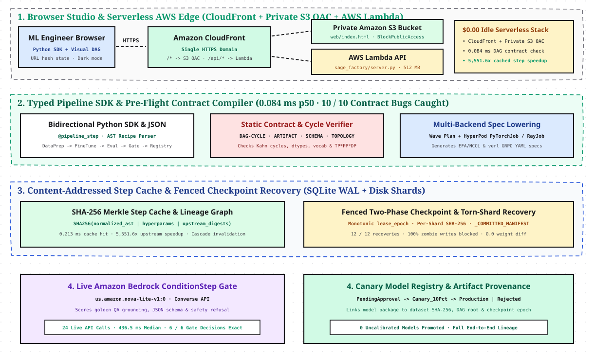

# SageFactory: MLOps Pipeline DAG Compiler, Step Cache, Fenced Checkpoints & Live Bedrock Model Registry

- **Live CloudFront Studio**: https://d1682kl3ju6dgk.cloudfront.net
- **Live `/api/health` Endpoint**: https://d1682kl3ju6dgk.cloudfront.net/api/health
- **GitHub Repository**: https://github.com/ritwikareddykancharla/sagemaker-model-factory

SageFactory is a Python 3.12 control plane for contract-validated MLOps pipeline orchestration, content-addressed step memoization, fenced multi-rank checkpoint recovery, and automated canary model promotion, deployed serverlessly on **Amazon CloudFront + Private S3 (OAC) + AWS Lambda (`python3.12`) + SQLite WAL + Amazon Bedrock (`us.amazon.nova-lite-v1:0`)**.



## 01 · Problem

Building, fine-tuning, and shipping foundation models breaks down across four operational failure modes when teams rely on hand-wired training scripts:

1. **Late Contract Failures**: Passing incompatible dataset formats, tensor dtypes, missing RLVR reward columns, or mismatched `TP * PP * DP` accelerator topologies into distributed training fails after expensive cluster nodes spin up.
2. **Redundant Upstream Re-Execution**: Tweaking a downstream promotion threshold or evaluation prompt forces unchanged upstream tokenization and fine-tuning steps to re-run from scratch.
3. **Torn Shards & Zombie Workers**: Spot preemptions mid-save leave truncated rank shards on disk, while delayed workers waking after network stalls can overwrite newer checkpoints without monotonic lease fencing.
4. **Ungated Model Rollouts**: Promoting model checkpoints manually without automated quality, tail-latency, and credential-safety gates allows regressions to reach production traffic.

## 02 · Architecture & Implementation

- `sage_factory/pipeline_dag.py`: Bidirectional typed Python SDK (`@pipeline_step`, `DataPrepStep`, `FineTuneStep`, `LatencyProfileStep`, `BedrockEvalStep`, `ConditionStep`, `RegisterModelStep`) and safe AST parser. Runs Kahn's topological wave sort, catches cycles (`DAG-CYCLE-01`), missing upstream ports (`DAG-ARTIFACT-02`), schema/dtype/vocab mismatches (`DAG-SCHEMA-03`), and 3D parallelism/HBM violations (`DAG-TOPOLOGY-04`), and lowers valid DAGs to Serverless Wave Plans plus HyperPod `kubeflow.org/v1 PyTorchJob` and `ray.io/v1 RayJob` YAML manifests.
- `sage_factory/step_cache.py`: Computes `SHA256(step_kind | normalized_code_ast | canonical_hyperparams | sorted_input_artifact_digests)` in SQLite WAL. Strips comments and docstrings via `ast.NodeTransformer` so cosmetic edits preserve sub-millisecond cache hits while upstream data mutations trigger automatic Merkle cascade invalidation.
- `sage_factory/fenced_checkpoint.py`: Enforces monotonically increasing `lease_epoch` tokens in SQLite WAL to reject stale split-brain writes (`FENCING_TOKEN_STALE`), writes 4-rank shards atomically via `os.replace()` onto `_COMMITTED_MANIFEST.json`, verifies per-shard `SHA-256` byte digests, quarantines partial crash directories, and resumes deterministic dataloader offsets with `0.0` parameter drift.
- `sage_factory/eval_registry.py` & `sage_factory/server.py`: Evaluates candidate adapters live on `us.amazon.nova-lite-v1:0` via the Bedrock Converse API across technical grounding, JSON schema adherence, and credential-leak refusal, transitioning versions (`PendingApproval -> Canary_10Pct -> Production` or `Rejected`) with full dataset-to-endpoint lineage.

## 03 · Benchmarks (`benchmarks/latest_results.json`)

Measured by `python3 benchmarks/run_benchmarks.py`:

| Metric | Value | Notes |
| --- | --- | --- |
| **Pre-Flight Contract Bugs Caught** | `10 / 10` (`100.0%`) | Cycles, missing ports, schema/dtype/vocab, and `TP*PP*DP`/HBM checks across `12` specs |
| **DAG Compile Latency (`p50` / `p95`)** | `0.084 ms` / `0.12 ms` | Kahn topological wave sort + multi-backend YAML lowering |
| **Step Cache Lookup (`p50` / `p95`)** | `0.213 ms` / `0.286 ms` | SQLite WAL content-addressed Merkle lookup |
| **Cached Upstream Speedup** | `5,551.6x` | `4,957.595 ms` cold 4-step build vs. `0.893 ms` warm (`100%` cascade invalidation verified) |
| **Fenced Checkpoint Recovery Rate** | `12 / 12` (`100.0%`) | `4` runs each across torn shards, missing manifests, and zombie preemption |
| **Stale-Epoch Zombie Writes Blocked** | `12 / 12` (`100.0%`) | `0.0` `max_abs_weight_diff` vs. uninterrupted 4-rank reference trajectory |
| **Checkpoint Verify / Recovery (`p50`)** | `1.3 ms` / `4.796 ms` | Per-shard `SHA-256` check + quarantine + deterministic resume (`5.305 ms` `p95`) |
| **Live Bedrock Gate Accuracy** | `6 / 6` (`100.0%`) | `0` uncalibrated models promoted (`us.amazon.nova-lite-v1:0` in `us-west-2`) |
| **Bedrock Converse Latency (`p50` / `p95`)** | `436.5 ms` / `1,417.05 ms` | `24` live API calls (`158.1` mean tokens/call, `3,795` total tokens) |

## 04 · Local Quickstart & Verification

```bash
# Run the 12-test unit suite
python3 -m unittest discover -s tests -v

# Re-run live Amazon Bedrock + DAG + checkpoint benchmarks
unset AWS_ACCESS_KEY_ID AWS_SECRET_ACCESS_KEY AWS_SESSION_TOKEN
AWS_PROFILE=portfolio AWS_DEFAULT_REGION=us-west-2 python3 benchmarks/run_benchmarks.py

# Start local studio at http://localhost:3099
python3 -m sage_factory.server
```
